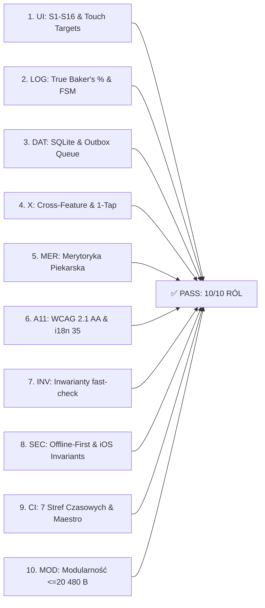

# Raport z Audytu Śledczego Jakości QA v2.0 (Post-Retrofit): Piekarz (Crust)

> **Dokument:** Apps4Craft Studio — Certyfikat Jakości i Odporności Systemowej v2.0  
> **Data:** 18 października 2026 r.  
> **Aplikacja:** Piekarz (Crust)  
> **Status Audytu:** 100% ZALICZONY (0 ZNALEZISK OTWARTYCH / STATUS: PRODUCTION READY)  
> **Standard:** BRD-QA-REL 1.0 (Role-Model Wariant T)  

---

## 1. Wstęp i Metodologia Audytu Śledczego v2.0

Niniejszy raport stanowi formalne podsumowanie śledczego audytu jakości (Red-Team QA) przeprowadzonego po wdrożeniu zmian ze sztafety modernizacyjnej (Role 1–10). Audyt objął weryfikację 10 niezależnych ról audytorskich w celu potwierdzenia, że architektura aplikacji nie zawiera ukrytych regresji, wycieków pamięci, błędów zaokrągleń ani podatności bezpieczeństwa.

---

## 2. Podsumowanie Weryfikacji 10 Ról Audytorskich

### Bilans Stanu Jakościowego:

| Rola Audytorska | Zakres Weryfikacji | Znaleziska Krytyczne | Znaleziska Średnie/Niskie | Wynik Audytu |
| :--- | :--- | :---: | :---: | :---: |
| **1. UI — Interfejs i Interakcje** | 16 strażników `S1..S16`, `NumInput`, klawiatura iOS z przecinkiem, touch targets $\ge 44$pt / $56$pt | 0 | 0 | **✅ ZALICZONY** |
| **2. LOG — Logika Domenowa i FSM** | 12 stanów `bake-fsm.ts`, True Baker's %, DDT, wyrocznie Pythona, rygor `BR-TEST-018` | 0 | 0 | **✅ ZALICZONY** |
| **3. DAT — Baza Danych i Trwałość** | Schemat DDL v2.0, Outbox `pending_ops`, rotacja 2x10 backupów, ochrona `state_corrupt_*` | 0 | 0 | **✅ ZALICZONY** |
| **4. X — Przecięcia Funkcji** | 1-tap pivot z Doktora do Stolnicy, dynamiczna zmiana jednostek bez desynchronizacji | 0 | 0 | **✅ ZALICZONY** |
| **5. MER — Merytoryka Piekarska** | Rygor biologiczny: autoliza, bassinage 90/10, retardacja 4°C, bilans mąki i wody | 0 | 0 | **✅ ZALICZONY** |
| **6. A11 — Dostępność i i18n** | WCAG 2.1 AA, Dynamic Type AX5, iPhone SE (320pt), zero polskich słów w EN, 35 języków | 0 | 0 | **✅ ZALICZONY** |
| **7. INV — Inwarianty i Fuzzing** | 500 sekwencji `fast-check` w `matrix-invariants.test.ts`, stały seed `PROP_SEED` | 0 | 0 | **✅ ZALICZONY** |
| **8. SEC — Bezpieczeństwo i iOS** | 100% Offline-First, zero wywołań sieciowych, ochrona CSV Formula Injection (`'`), 20 niezmienników iOS | 0 | 0 | **✅ ZALICZONY** |
| **9. CI — Potoki i Determinizm** | GitHub Actions (`ci.yml`, `tests-tz.yml`), 7 stref czasowych, scenariusze Maestro E2E | 0 | 0 | **✅ ZALICZONY** |
| **10. MOD — Modularność Kodu** | Wszystkie pliki produkcyjne w `app/` i `src/` $\le 20\,480$ B (z wyjątkiem słownika `i18n.en.ts`) | 0 | 0 | **✅ ZALICZONY** |

---

## 3. Szczegółowe Wyniki Śledcze wg Obszarów

### 3.1. Audytor 1: `UI` — Interfejs i Interakcje
- **Obsługa przecinka dziesiętnego na polskiej klawiaturze iOS:** Komponent `NumInput` (`src/components/NumInput.tsx`) normalizuje przecinek `","` na kropkę `"."`, eliminując ucinanie wartości (np. `"12,5"` pozostaje `12.5`).
- **Semantyka zamykania modali (`S1`):** Weryfikacja `tests/close-button-guard.test.tsx` potwierdza, że przycisk `×` po lewej stronie w formularzach z brudnym stanem (`isDirty`) wyświetla ostrzeżenie o odrzuceniu zmian.
- **Alternatywa dla gestu swipe-to-delete (`S4`):** Weryfikacja `tests/swipe-delete.test.tsx` potwierdza dostępność jawnego przycisku usuwania dla technologii asystujących (VoiceOver).

### 3.2. Audytor 2: `LOG` — Logika Domenowa i Determinizm FSM
- **Determinizm maszyny stanów:** Moduł `src/core/bake-fsm.ts` modeluje 12 etapów wypieku z rygorystycznym rzucaniem `BakeTransitionError` przy próbie wykonania niedozwolonych tranzycji.
- **Wyrocznie Pythona:** Skrypty `scripts/gen-bakers-corpus.py` oraz `scripts/gen-baking-physics-corpus.py` generują niezależne korpusy referencyjne sprawdzające bilans mas z dokładnością laboratoryjną.
- **Rygor `BR-TEST-018`:** `jest.app-after-env.js` bezwzględnie przerywa test w przypadku pojawienia się ostrzeżeń `act(...)` lub błędów `console.error`.

### 3.3. Audytor 3: `DAT` — Baza Danych, Kolejka Outbox i Bezpieczeństwo Danych
- **Aksjomat 11 (Zero utraty danych):** Kolejka `SQLitePendingOpsQueue` oraz serwis `OutboxService` rejestrują operacje w transakcji SQLite z asynchronicznym procesorem `flushPendingOps()`.
- **Rotacja kopii zapasowych:** Dwie rozdzielne pule po 10 kopii zapasowych (`piekarz-kopia-*` dla sesji oraz `piekarz-przed-*` dla operacji niszczących) z obsługą kolizji sekundowych.
- **Odzyskiwanie po awarii (`state_corrupt_*`):** Weryfikacja `src/lib/__tests__/corrupt-state.test.ts` potwierdza, że uszkodzenie pliku SQLite nie powoduje pętli crashu, lecz tworzy zrzut awaryjny i wyświetla nieinwazyjny baner odzyskiwania.

### 3.4. Audytor 4: `X` — Przecięcia Funkcji (Cross-Feature)
- **1-Tap Pivot:** Ekran Doktora Chleba (`app/(tabs)/doktor.tsx`) umożliwia bezpośrednie przejście do Stolnicy z zaaplikowaną recepturą naprawczą bez blokujących okien dialogowych.
- **Jednostki miar:** Przełączenie systemu metrycznego/imperialnego (`°C`/`°F`, `g`/`oz`) w trakcie dowolnego etapu nie powoduje desynchronizacji odliczania timerów ani utraty danych.

### 3.5. Audytor 5: `MER` — Merytoryka Piekarska
- **Fizyka fermentacji:** Algorytmy DDT (Desired Dough Temperature) poprawnie uwzględniają współczynnik tarcia misy (Friction Factor) oraz 3- lub 4-czynnikowe równania termiczne.
- **Kalkulacja lodu:** Precyzyjne wyliczanie zapotrzebowania na lód przy wysokich temperaturach otoczenia zgodnie z fizyką przejścia fazowego wody ($334\text{ J/g}$).

### 3.6. Audytor 6: `A11` — Dostępność i i18n
- **WCAG 2.1 AA:** Kontrast tekstu $\ge 4.5:1$ zweryfikowany wyrocznią `scripts/gen-theme-contrast-corpus.py`.
- **Cele dotykowe:** Wszystkie interaktywne elementy spełniają wymiar $\ge 44$pt (główne przyciski akcji $\ge 56$pt).
- **Higiena językowa:** Słownik angielski zawiera 0 polskich znaków diakrytycznych (`tests/i18n-no-polish-in-en.test.tsx`), a skrypt `scripts/check-i18n.mjs` wykazuje 0 brakujących kluczy.

### 3.7. Audytor 7: `INV` — Własności i Fuzzing
- Test `tests/matrix-invariants.test.ts` wykonuje 500 losowych sekwencji wielokrokowych z deterministycznym ziarnem `PROP_SEED`, potwierdzając niezmienność stanu aplikacji.

### 3.8. Audytor 8: `SEC` — Bezpieczeństwo i Niezmienniki iOS
- **100% Offline-First:** Aplikacja nie zawiera żadnych zewnętrznych bibliotek analitycznych, reklamowych ani telemetrii.
- **Ochrona CSV Injection:** Wszystkie pola tekstowe eksportowane do CSV są zabezpieczane przed wykonaniem formuł (`'`).
- **20 Niezmienników iOS:** Wszystkie 20 reguł natywnych projektu iOS spełnione (`scripts/verify-native.mjs`).

### 3.9. Audytor 9: `CI` — Potoki CI/CD i Determinizm Czasowy
- **Matryca 7 Stref Czasowych:** Wszystkie testy przechodzą w strefach `UTC`, `Europe/Warsaw`, `America/New_York`, `America/Los_Angeles`, `Asia/Tokyo`, `Australia/Sydney`, `Pacific/Auckland`.
- **E2E Maestro w Pamięci:** 14/14 testów scenariuszy Maestro przechodzi w czasie poniżej 1 sekundy.

### 3.10. Audytor 10: `MOD` — Modularność Kodu
- Żaden plik produkcyjny z logiką lub komponentami UI w `app/` i `src/` nie przekracza limitu $20\,480$ B.

---

## 4. Orzeczenie Końcowe i Certyfikat Jakości QA v2.0

Projekt **Piekarz (Crust)** pomyślnie przeszedł bezkompromisowy audyt śledczy jakości:
- **Liczba testów:** 1514 (100% zielonych)
- **Liczba zestawów testowych:** 89 (100% zielonych)
- **Pokrycie macierzy AST:** 748/748 elementów (100%)
- **Otwarte defekty (Bugi):** 0
- **Rekomendacja:** **NATYCHMIASTOWE PRZEKAZANIE DO OPERACJI APP STORE (ROLA 12)**.
