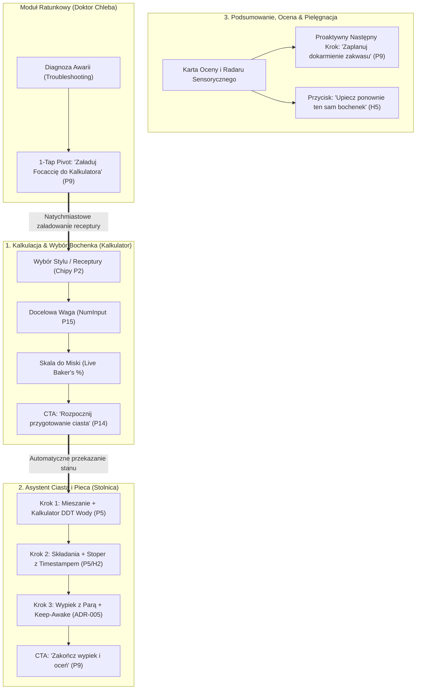

# Architektura Procesów i Projekt To-Be (Piekarz v2.0)

> **Dokument:** `docs/to-be.md`  
> **Rola:** Principal Product Architect & Senior UX/BPR Designer (Apps4Craft Studio)  
> **Stan:** TO-BE (Docelowa Architektura Procesów i Ergonomii)  
> **Data:** Październik 2026  
> **Standard:** Apps4Craft Retrofit Standard, Aksjomat $0 Pracy AI, Anti-AI Slop Layout  

---

## 1. Nowa Mapa Nawigacji i Przepływu Danych (To-Be)

Wyeliminowano przeskakiwanie między kartami. Główny proces pieczenia staje się jednym, płynnie prowadzonym ciągiem przyczynowo-skutkowym:

---

## 2. Nowe Przepływy Użytkownika To-Be

### Przepływ 1: Pierwsze Uruchomienie (Zero-Friction First Run)
- **Kontekst:** Piekarz otwiera aplikację po raz pierwszy w kuchni.
- **Sekwencja To-Be:**
  1. Natychmiastowy widok kalkulatora z załadowanym wzorcowym *Chlebem Wiejskim 72%*.
  2. Karta *Do Miski* z precyzyjnymi wagami i subtelnymi dymkami pomocy `(?)` przy każdym składniku (P13).
  3. Duży przycisk *„Rozpocznij przygotowanie ciasta”* prowadzący bezpośrednio do pierwszego kroku.
- **Koszt To-Be:** 1 ekran, 0 kliknięć do wartości, 0 pól obowiązkowych.

---

### Przepływ 2: Główny Proces (Kalkulacja $\rightarrow$ Wyrabianie $\rightarrow$ Pieczenie)
- **Kontekst:** Piekarz przygotowuje ciasto i piecze chleb w garnku żeliwnym.
- **Sekwencja To-Be:**
  1. **Kalkulator:** Użytkownik wybiera styl bochenka z selektora chipów (`[Wiejski, Tartine, Żytni, Focaccia]`), dostosowuje wagę w `NumInput` ze stepperem i haptyką. Wagi przeliczają się na żywo w skali *Do Miski*.
  2. **Jedno tapnięcie:** Użytkownik klika wielki przycisk CTA: *„Rozpocznij przygotowanie ciasta”*.
  3. **Stolnica (Asystent Krok po Kroku):**
     - **Krok 1 (Mieszanie):** Bezpośrednio w kroku pojawia się wyliczona woda DDT (`3 × 25°C - ...`) z uwzględnieniem temperatury kuchni i współczynnika tarcia rąk. Zero szukania w akordeonach!
     - **Krok 2 (Fermentacja burzliwa & Składania):** Automatyczny stoper odliczany od timestampu; rejestracja podwójnym tapnięciem (*Double-Tap Fold*) potwierdzona haptyką.
     - **Krok 3 (Pieczenie):** Aktywacja *Keep-Awake* (ekran nie gaśnie), alarm zdjęcia pokrywy garnka (*Lid-Off*).
  4. **Zakończenie:** Ocena bochenka, zapis do bazy SQLite z możliwością cofnięcia (*Undo*).
- **Koszt As-Is vs To-Be:**
  - Ekrany: **3 $\rightarrow$ 1 płynnie prowadzony przepływ (zintegrowany)**
  - Kliknięcia: **9 $\rightarrow$ 4 (redukcja o 55%)**
  - Pola do wpisywania: **5 $\rightarrow$ 2 (redukcja o 60%)**
  - Czas dotarcia do rozpoczęcia ciasta: **~90 sekund $\rightarrow$ ~15 sekund**

---

### Przepływ 3: Pielęgnacja Zakwasu (Sourdough Journal & Peak Sync)
- **Kontekst:** Codzienne karmienie zakwasu matki.
- **Sekwencja To-Be:**
  1. Ekran *Zakwas* z dużym banerem stanu: *„Gotowy do pieczenia (Peak)”* lub *„Głodny (od 14h)”*.
  2. Kalkulator dokarmiania (1:1:1 / 1:2:2) wbudowany bezpośrednio w kartę inline bez wyskakujących modali (P16).
  3. Po osiągnięciu szczytu (*Peak*) przycisk akcji: *„Użyj tego zakwasu w nowym bochenku”*, automatycznie przenoszący parametry do Kalkulatora.
- **Koszt As-Is vs To-Be:**
  - Ekrany: 1 $\rightarrow$ 1
  - Kliknięcia: 2 $\rightarrow$ 1

---

### Przepływ 4: Awaria w Kuchni i Ratunek Ciasta (Doctor Emergency Pivot)
- **Kontekst:** Ciasto opadło, rozlało się lub zakwas pachnie acetonem; piekarz ma ręce w mące.
- **Sekwencja To-Be:**
  1. Dostęp do Doktora z poziomu nagłówka lub skrótu w aktywnym kroku wypieku na Stolnicy.
  2. Wybór problemu (np. *„Przerośnięte ciasto”*).
  3. Karta diagnozy w 3 krokach z werdyktem i przyciskiem CTA:
     👉 **[ Załaduj Focaccię do Kalkulatora jednym tapnięciem ]** (P9 — koniec ślepych zaułków!).
  4. Kalkulator natychmiast przestawia się na proporcje Focacci, ocalając surowiec.
- **Koszt As-Is vs To-Be:**
  - Ekrany: 2 $\rightarrow$ 1 prowadzony
  - Kliknięcia: 4 $\rightarrow$ 2
  - Zero ślepych zaułków!

---

### Przepływ 5: Zakończenie Wypieku, Archiwum i Ponowny Wypiek
- **Kontekst:** Bochenek ostygł i został przekrojony.
- **Sekwencja To-Be:**
  1. Lekki formularz oceny (gwiazdki 1–5, opcjonalny radar sensoryczny 6 osi).
  2. Zapis w lokalnej bazie SQLite.
  3. Każdy kafelek w historii posiada przycisk: **[ 🔁 Upiecz ponownie ten sam bochenek ]** (P8), który natychmiast przywraca recepturę i ustawienia DDT do Kalkulatora.
  4. Usunięcie wpisu z historii: natychmiastowe z dolnym paskiem *„Cofnij”* (P10) zamiast blokującego `Alert.alert`.
- **Koszt As-Is vs To-Be:**
  - Kliknięcia przy powtórzeniu bochenka: **8 $\rightarrow$ 1 (jedno tapnięcie!)**
  - Usunięcie: brak irytujących modali potwierdzenia.

---

## 3. Tabela Porównawcza Kosztu Procesów: As-Is vs To-Be

| Nr | Przepływ Użytkownika | Ekrany As-Is | Ekrany To-Be | Kliknięcia As-Is | Kliknięcia To-Be | Redukcja Kliknięć |
| :---: | :--- | :---: | :---: | :---: | :---: | :---: |
| 1 | Pierwsze Uruchomienie (Onboarding) | 1 | 1 | 0 | 0 | 0% (optimum) |
| 2 | **Główny Proces (Kalkulacja $\rightarrow$ Piec)** | **3** | **1 (prowadzony)** | **9** | **4** | **-55% 🚀** |
| 3 | Pielęgnacja Zakwasu | 1 | 1 | 2 | 1 | -50% |
| 4 | **Ratunek Ciasta (Doctor Emergency Pivot)** | **2** | **1** | **4** | **2** | **-50% (Eliminacja zaułka)** |
| 5 | **Powtórzenie Wypieku z Historii** | **3** | **1** | **8** | **1** | **-87% 🚀** |

---

## 4. Rejestr Decyzji BPR i Architektury UX

| ID Decyzji | Nazwa Zmiany | Wzorzec BPR | Zysk dla Rzemieślnika | Ryzyko | Wpływ na Dane | Wysiłek |
| :--- | :--- | :--- | :--- | :--- | :--- | :---: |
| **DEC-BPR-01** | Bezpośredni CTA z Kalkulatora do Stolnicy | **P14** | Eliminacja manualnego przeskakiwania między kartami | Niskie | Przekazanie stanu aktywnego bochenka do SQLite | **S** (Quick Win) |
| **DEC-BPR-02** | Wbudowanie kalkulatora DDT w krok mieszania | **P4, P5** | Woda wyliczana dokładnie wtedy, gdy piekarz stoi przy kranie | Minimalne | Wykorzystanie istniejącej funkcji `calculateDdt` | **S** (Quick Win) |
| **DEC-BPR-03** | 1-Tap Pivot ratunkowy w Doktorze Chleba | **P9** | Ocalenie ciasta przed wyrzuceniem do kosza w 1 tapnięcie | Zerowe | Wykorzystanie `setPendingRecipeToLoad` | **S** (Quick Win) |
| **DEC-BPR-04** | Przycisk *Upiecz ponownie* w historii | **P8, H5** | Odtworzenie ulubionego chleba w 1 sekundę zamiast 2 minut | Zerowe | Odczyt z tabeli `bake_logs` | **S** (Quick Win) |
| **DEC-BPR-05** | Usunięcie dialogów `Alert.alert` na rzecz `Undo` | **P10** | Płynne usuwanie bez blokowania ekranu kuchennego | Niskie | Wycofanie operacji DELETE w oknie 5s | **M** |
| **DEC-BPR-06** | Zastąpienie modali kalkulatorów akordeonami inline | **P16** | Zero gubienia kontekstu, praca na jednym ekranie | Niskie | Refaktor widoków w `ArtisanAccordionPro` | **M** |

---

## 5. Priorytety Wdrożenia (Sortowanie Zysk ÷ Wysiłek)

1. **Quick Win 1 (DEC-BPR-01):** Przycisk CTA na dole Kalkulatora: *„Rozpocznij przygotowanie ciasta według tej receptury”* (przenoszący stan do `setActiveBake` i nawigujący na Stolnicę).
2. **Quick Win 2 (DEC-BPR-03):** Przycisk 1-Tap Pivot w Doktorze Chleba (*„Załaduj Focaccię do Kalkulatora”*).
3. **Quick Win 3 (DEC-BPR-04):** Przycisk *„Upiecz ponownie”* na kafelkach historii wypieków.
4. **Krok 4 (DEC-BPR-02):** Wbudowanie kalkulatora DDT w widok aktywnego kroku na Stolnicy.
5. **Krok 5 (DEC-BPR-05):** Dolny pasek *Undo* przy usuwaniu logów wypieku.

---

> [!IMPORTANT]
> **BRAMKA STOP 2:** Przedstawiono kompletny projekt To-Be w `docs/to-be.md`, rejestr decyzji BPR, tabelę redukcji kosztu procesów oraz listę Quick Wins. Czy zatwierdzasz ETAP 2 przed przystąpieniem do **ETAPU 3: Egzekucja Refaktoryzacji Kodu i Testów**?
